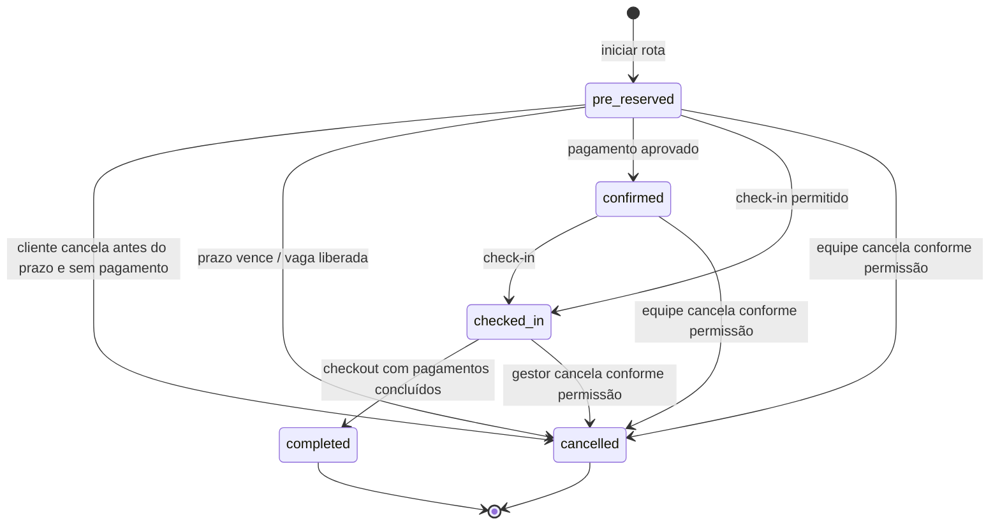

# Ciclo de vida da reserva

Este documento descreve os estados que a API persiste e as ações que os alteram. `status` representa a operação da vaga; `payment_status` representa o pagamento. Os dois campos não devem ser usados como sinônimos.

## Estados operacionais

| Estado persistido | Significado | Bloqueia vaga? | Próximas ações válidas |
| --- | --- | --- | --- |
| `pre_reserved` | Pré-reserva criada ao iniciar a rota; mantém a vaga até `hold_expires_at`. | Sim, até cancelar ou expirar. | Cliente pode cancelar enquanto não paga e o prazo está válido; check-in; pagamento pode confirmar. |
| `confirmed` | Pagamento da reserva aprovado antes do check-in. | Sim. | Check-in; cancelamento administrativo conforme permissão. |
| `checked_in` | Veículo entrou e a permanência começou. | Sim. | Pagamento pendente, se houver; checkout. Cliente não pode cancelar. |
| `completed` | Checkout concluído e vaga liberada. | Não. | Estado terminal; avaliação e consulta do comprovante. |
| `cancelled` | Reserva cancelada por cliente, equipe ou expiração. | Não. | Estado terminal. A causa fica em `cancellation_reason`; o ator humano fica em `cancelled_by_user_id`. |

Uma pré-reserva vencida também é persistida como `status=cancelled`, com `payment_status=expired` e motivo automático. O app apresenta esse caso como **Expirada**, para distinguir expiração de cancelamento manual. A expiração é aplicada quando a API consulta ou opera as reservas do estacionamento; não há um worker periódico dedicado no MVP.

## Pagamento

O status de pagamento é independente do estado operacional. Valores usados atualmente incluem `pending_checkin`, `paid`, `expired`, `cancelled`, `checkout_payment_pending` e `checkout_excess_pending`. Uma confirmação de pagamento da reserva grava também `payment_method` na reserva; quando ocorre antes do check-in, a API move a operação para `confirmed`. Pagamento simulado só vale no ambiente local de teste.

Checkout só conclui quando o pagamento exigido pela reserva e qualquer excedente calculado estiverem quitados. A conclusão grava `checked_out_at`, move a reserva para `completed` e devolve a vaga à disponibilidade.

## Regra de cancelamento vigente

- Cliente só cancela a própria `pre_reserved`, sem pagamento aprovado e antes de `hold_expires_at`; o valor de taxa é zero.
- Pré-reserva expirada já é terminal e não pode ser cancelada novamente.
- Reserva `confirmed`/paga não pode usar o cancelamento direto. O fluxo de solicitação, análise e execução de reembolso ainda precisa ser implementado; não informar que o estorno foi iniciado.
- Cliente não cancela depois do check-in.
- Operador só cancela dentro do tenant, sem check-in, e nas regras de propriedade atualmente aplicadas pela API. Gestor/admin do parceiro pode cancelar dentro do tenant, inclusive após check-in.
- O cálculo de taxa para cancelamento feito pela equipe começa depois de cinco minutos e lê a taxa `cancellation` configurada. O endpoint registra o valor calculado, mas não captura esse valor nem efetua reembolso automaticamente.
- `cancelled_by_user_id`, `cancelled_by_name`, `cancelled_at` e `cancellation_reason` guardam a trilha de auditoria.

O cliente deve ver o botão de cancelar somente quando a API ainda aceitaria o cancelamento direto. A API continua sendo a autoridade final; o botão é apenas uma indicação da regra e pode perder validade se o prazo terminar enquanto a tela está aberta.

## Identificadores UUID

As entidades usam UUID de 36 caracteres para manter IDs únicos entre tenants, unidades, ambientes e futuras integrações, sem depender de uma sequência central ou expor uma contagem sequencial de cadastros. UUID não é segredo e não substitui autorização: todos os endpoints ainda precisam verificar usuário, tenant, unidade e papel. O app pode mostrar um código curto legível, como `PH-XXXXXXXX`, derivado do ID, enquanto mantém o UUID como chave técnica.

Não se recomenda migrar IDs existentes para inteiros neste momento. A troca afetaria chaves estrangeiras, seeds, payloads, cache e clientes já instalados, sem melhorar as regras de acesso. A decisão deve ser revisitada apenas se aparecer uma necessidade mensurável de armazenamento, indexação ou compatibilidade.

## `BaseModel` e exclusão lógica

Todas as entidades derivadas de `BaseModel` recebem `created_at`, `updated_at` e `deleted_at`. O `updated_at` com `server_default=now()` e `onupdate=now()` é adequado para operações ORM da aplicação. `onupdate` é executado pelo SQLAlchemy em updates ORM; comandos SQL externos não são obrigados a atualizar o campo. Embora a coluna seja declarada `DateTime(timezone=True)`, MySQL armazena `DATETIME` sem fuso; a aplicação deve continuar gravando e interpretando esses valores em UTC. `deleted_at` nulo significa registro ativo; uma data significa removido logicamente. A desativação de usuário mantém `is_active=false` e grava `deleted_at`, sem apagar histórico ou relações. Reativar limpa `deleted_at` e volta `is_active=true`.

Como essas colunas são herdadas por todas as tabelas do modelo, qualquer alteração no `BaseModel` precisa de migration que cubra todas elas. Consultas de usuários e autenticação devem excluir registros com `deleted_at` preenchido.
